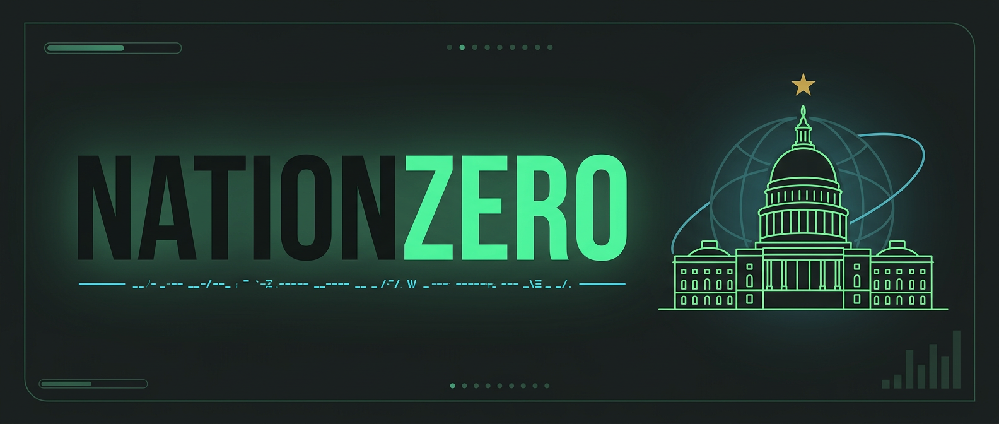

# 🏛️ NationZero

**Um país inteiro nas suas mãos.** Você começa como um cidadão comum — e termina como quiser:
presidente reeleito, ditador de mão de ferro, monarca coroado, ou um desastre nacional que virou piada internacional.

> Simulador de poder e política em português. Roda no **navegador**, **Windows (.exe)**, **Linux (.AppImage/.deb)**,
> **macOS (.dmg)**, **Android (.apk)** e **iOS (.ipa)** — tudo a partir do mesmo código.

---

## 🎮 O que você pode fazer

### Política completa
- **Fundar seu partido** — nome, sigla, cor, símbolo, slogan e seis eixos ideológicos (economia, ordem, nação, religião, ecologia, costumes).
- **Carreira completa**: cidadão → ativista → líder de partido → deputado → ministro → vice-presidente → presidente → (ditador/monarca).
- **Eleições** a cada 4 anos, parlamento com 300 cadeiras, campanhas, comícios, compra de votos, manipulação do sistema eleitoral.
- **Plebiscitos**, dissolução do parlamento, fechamento do Congresso, adiamento de eleições, autoanistia.

### Escreva as regras
**80 leis** em 13 categorias: reforma agrária, renda básica, imposto único, privatização, nacionalização,
semana de 4 dias, saúde universal, pena de morte, censura, partido único, vigilância em massa,
religião oficial, programa atômico, lei marcial, nova Constituição, monarquia, voto censitário…
E **decretos personalizados**: você escolhe nome, justificativa e até 3 medidas — o jogo não limita sua criatividade.

### Poder sem limites
- **Golpe militar**, **autogolpe** e **proclamação de ditadura** com cálculo real de chance (lealdade militar, controle das Forças Armadas, poder, estabilidade, aprovação).
- **Purgas** com 8 tipos de alvo e 5 métodos (demissão, prisão, exílio, desaparecimento, execução) — cada um com risco de vazamento.
- Subordinar Judiciário, intervir na imprensa, comprar militares, criar milícias, cercar a capital, culto à personalidade.
- Regimes: democracia, semidemocracia, autoritarismo, partido único, teocracia, tecnocracia, monarquia, junta militar, colapso.

### Mundo
**10 países** com personalidade própria, relações bilaterais, 6 tipos de tratados, ajuda externa, sanções,
espionagem, sabotagem econômica, desinformação, assassinato de líderes, golpes no exterior, exportação da revolução e **guerra** com frentes e baixas.

### Economia viva
Impostos (renda, empresas, consumo, patrimônio, tarifas) e 8 áreas de gasto ajustáveis. Receita, despesa,
dívida com juros, inflação, desemprego, crescimento, evasão por corrupção, sanções, emissão de títulos, calote, ajuste fiscal, estatização de bancos.

### Sociedade que reage
**12 facções** observam você: empresariado, financeiro, trabalhadores, camponeses, militares, igrejas, imprensa, juventude, intelectuais, minorias, nacionalistas e polícia. Cada decisão muda quem te ama e quem te odeia.
Tudo alimenta aprovação, estabilidade, agitação e o **risco de golpe contra você**.

### Consequências de verdade
- **54 eventos** com escolhas (crise cambial, greve geral, apagão, escândalo de corrupção, protestos, pandemia, seca, migração, motim militar, primavera, mandado internacional, bomba e bunker…).
- **Fim de jogo**: impeachment, golpe, revolução, hiperinflação, colapso econômico, renúncia forçada.
- **Legado**: 15 conquistas, estatísticas de golpes, purgas, guerras e anos no poder.

---

## 🚀 Jogar agora

### No navegador
Abra o `index.html` da pasta `www/` **através de um servidor** (o jogo usa módulos ES):

```bash
npm run serve
# abra http://localhost:4173
```

Também dá para instalar como aplicativo (PWA): no Chrome/Android use "Instalar aplicativo";
no iPhone, Safari → Compartilhar → "Adicionar à Tela de Início". O jogo funciona **offline** depois de carregado.

### 🌍 Jogar online (GitHub Pages)
Depois de ativar em **Settings → Pages → Source: GitHub Actions**, cada push na `main` publica o jogo em:

**https://veexdevs.github.io/NationZero/**

### Baixar os executáveis
Os instaladores são gerados pelo GitHub Actions (não ficam versionados no repositório):

1. Vá em **Actions** no GitHub.
2. Escolha o workflow:
   - **Build Desktop (.exe / .dmg / .AppImage)** → baixe o artefato `NationZero-win`, `NationZero-mac` ou `NationZero-linux`.
   - **Build Android (.apk)** → baixe o artefato `NationZero-APK` (APK de debug, pronto para instalar).
   - **Build iOS (.ipa sem assinatura)** → baixe `NationZero-iOS-ipa`.
3. Ou crie uma tag para gerar uma **release** com todos os arquivos juntos (o link fica permanente):

```bash
git tag v1.0.0
git push origin v1.0.0
```

> ⚠️ **Sobre assinaturas**: os builds não são assinados digitalmente (não há certificado no projeto).
> - **Windows**: SmartScreen avisa → "Mais informações" → "Executar assim mesmo".
> - **macOS**: botão direito no app → "Abrir". Se bloquear: `xattr -dr com.apple.quarantine /Applications/NationZero.app`.
> - **Android**: ative "Instalar de fontes desconhecidas".
> - **iOS**: um `.ipa` sem assinatura **não instala** em iPhone normal. Para rodar no seu aparelho você precisa
>   de conta Apple Developer + provisioning profile (ou usar AltStore/Sideloadly com seu próprio Apple ID).

### Compilar você mesmo

```bash
npm install

npm run serve        # web
npm start            # desktop (Electron) em modo dev
npm test             # testes do motor (313 verificações)

npm run dist:win     # .exe (no Windows)
npm run dist:mac     # .dmg (no macOS)
npm run dist:linux   # .AppImage/.deb (no Linux)

npm run cap:add:android && npm run cap:sync && npm run cap:open:android   # APK via Android Studio
npm run cap:add:ios && npm run cap:sync && npm run cap:open:ios           # IPA via Xcode
```

---

## 🧠 Como o jogo funciona

Cada **mês** (um clique em *Avançar mês*, ou barra de espaço):

1. Entram receitas, saem despesas e juros da dívida.
2. Leis em vigor aplicam seus efeitos contínuos.
3. Gastos públicos puxam os indicadores de saúde, educação, infraestrutura, tecnologia e ambiente.
4. Economia e serviços ajustam inflação, desemprego e crescimento.
5. Sociedade recalcula aprovação, estabilidade, agitação, legitimidade, liberdades, corrupção e medo.
6. Facções reagem à sua ideologia e às suas decisões.
7. Instituições (mídia, Judiciário, polícia, Forças Armadas, sistema eleitoral) convergem para o nível de controle.
8. O mundo ajusta relações, sanções e reputação; guerras avançam.
9. Poder e influência se regeneram.
10. Um evento pode ocorrer. Eleições acontecem no prazo. O jogo checa condições de fim.

### Recursos
| Recurso | Para que serve | Como cresce |
|---|---|---|
| ⚡ **Poder** | golpes, purgas, decretos, coerção | legitimidade, controle institucional, medo, ser chefe de Estado |
| 🤝 **Influência** | leis, cargos, diplomacia, espionagem | aprovação, reputação, partido com muitos membros |
| 💰 **Tesouro** | tudo que custa dinheiro | arrecadação − gastos − juros |
| 👍 **Aprovação** | sobrevivência política | bases, serviços públicos, economia, ausência de crises |

### Dicas
- Não dá para agradar todos: escolha **quem** vai te sustentar.
- Repressão dá estabilidade rápida e ódio duradouro.
- Imprensa e juventude são os primeiros a virar contra você.
- Militares são o árbitro final — soldo, nacionalismo e "lei e ordem" os mantêm do seu lado.
- Tesouro no vermelho = inflação = ruas = queda.
- Ditador não precisa de eleições, **mas** precisa vigiar quem o vigia.

---

## 🗂️ Estrutura do projeto

```
www/                     # o jogo (ESM puro, sem bundler, sem dependências)
  index.html             # entrada + PWA
  manifest.webmanifest   # instalação como app
  sw.js                  # cache offline
  src/
    engine/              # regras: estado, simulação, política, mundo
      state.js           # atributos, facções, saves, aplicador de efeitos
      simulation.js      # tick mensal, economia, sociedade, eventos, fim de jogo
      politics.js        # carreira, eleições, golpes, purgas, leis, ações
      world.js           # diplomacia, espionagem, guerra
    data/                # conteúdo: leis, ações, eventos, países, origens
    ui/                  # interface: app, telas, modais, componentes
electron/                # casca desktop (.exe/.dmg/.AppImage) — CommonJS (main.cjs)
build/                   # ícones pré-gerados (web, Android, iOS) + arte original
scripts/                 # servidor local (serve.cjs), testes (test.cjs, ui-test.mjs), ícones
.github/workflows/       # CI: .exe/.dmg/.AppImage, .apk, .ipa e GitHub Pages
```

**Zero dependências no jogo.** HTML, CSS e JavaScript puro com módulos ES — fácil de modificar e impossível de "quebrar por atualização de biblioteca".

---

## 🧪 Testes

```bash
npm test
```

Valida a integridade de todos os dados (IDs únicos, escolhas de evento), limites de todos os atributos
após centenas de meses simulados, carreira e eleições, golpes, leis, diplomacia, guerra, save/load e desempenho.

---

## 🔧 Personalizar

- **Leis** → `www/src/data/laws.js` (copie um bloco e mude `id`, `name`, `desc`, `enact`, `tick`).
- **Ações** → `www/src/data/actions.js`.
- **Eventos** → `www/src/data/events.js`.
- **Países** → `www/src/data/world.js`.
- **Balanceamento** → `www/src/engine/simulation.js` (tudo é número; mexa com moderação).

---

## 📜 Licença

MIT — use, modifique, publique. Só não me culpe se você virar ditador.

Feito com 🏛️ por [Veexdevs](https://github.com/Veexdevs).
