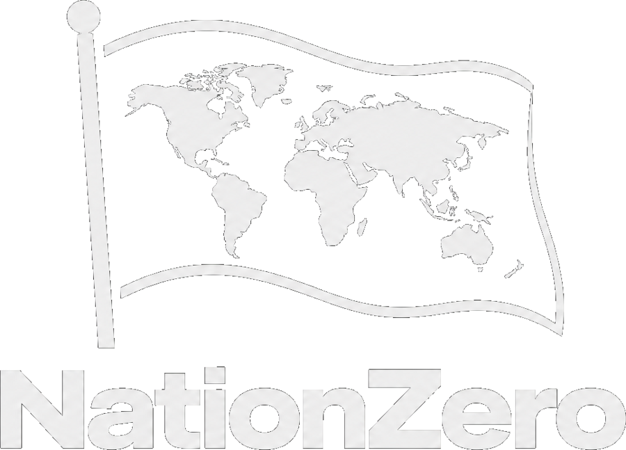

<p align="center">
  
</p>

# NationZero

**Grand strategy de mapa-múndi.** Escolha um país de verdade, assuma o poder e governe do primeiro ao último mês:
leis, partido, eleições, golpe, ditadura, espionagem, alianças — e conquista província por província até o mundo inteiro
estar pintado com a sua cor.

> **3.427 províncias · 172 países · mapa dinâmico em tela cheia (paisagem)**
> Roda no **navegador**, **Windows (.exe)**, **Linux (.AppImage/.deb)**, **macOS (.dmg)**,
> **Android (.apk)** e **iOS (.ipa)** — tudo a partir do mesmo código.

---

## Jogar agora

- **Web:** sirva a pasta `www/` (`npm run serve`) ou publique no GitHub Pages.
- **Downloads:** [releases do projeto](https://github.com/Veexdevs/NationZero/releases).

| Plataforma | Arquivo |
| --- | --- |
| Windows | `NationZero-2.0.0-x64.exe` / `-portable.exe` |
| macOS | `-x64.dmg` / `-arm64.dmg` (Apple Silicon) |
| Linux | `-x86_64.AppImage` / `-amd64.deb` |
| Android | `2.0.0.apk` |
| iOS | `NationZero-unsigned.ipa` (precisa de assinatura própria) |

---

## O mapa

- **3.427 províncias** desenhadas a partir de dados reais (Natural Earth), cada uma com população,
  desenvolvimento, guarnição, turbulência e construções.
- **172 países** com nome em português, região, população real, área e índice de desenvolvimento.
- **Mapa vivo:** cores políticas por dono, exércitos com números, frentes de guerra, capital marcada,
  zoom (roda do mouse, pinça, botões, teclado) e arraste livre.
- **Tela cheia e deitada:** interface pensada para paisagem — barra superior de recursos, trilha lateral de
  ministérios, painel deslizante e inspetor de província flutuante sobre o mapa.

## O que dá para fazer

### Conquista e guerra
- **Recrutar exércitos** província por província, com mão de obra e custo em tesouro.
- **Marchar** para províncias vizinhas; províncias inimigas geram **batalha** com moral, fortes e guarnição.
- **Ocupar, anexar e perder** território — e ser apagado do mapa se perder tudo.
- **Revoltas**: províncias ocupadas com turbulência alta voltam ao dono original.
- **Construções**: fábrica, forte, porto, escola e base militar, cada uma com efeito real.

### Diplomacia
Declarar guerra, propor paz, **alianças**, **acordos comerciais**, **sanções**, **espionagem**
(sabotagem, golpe, roubo), **exigir tributo**, melhorar relações e acompanhar o **ranking de poder** do mundo.
A IA declara guerras, assina pazes, recruta e se expande sozinha — o mapa muda mesmo se você não fizer nada.

### Política interna (herdada e expandida)
- **Fundar partido** com sigla, cor, símbolo, slogan e seis eixos ideológicos.
- **Eleições** a cada 4 anos, parlamento de 300 cadeiras, comícios, compra de votos, manipulação.
- **80 leis** em 13 categorias + **decretos personalizados** (você inventa nome, justificativa e medidas).
- **Golpe militar, autogolpe, ditadura, monarquia, teocracia, junta** — com cálculo de chance real.
- **Purgas**, censura, controle do Judiciário, milícias, culto à personalidade, plebiscitos.
- **Economia viva**: 5 impostos, 8 áreas de gasto, dívida com juros, inflação, desemprego, corrupção,
  calote, estatização, ajuste fiscal.
- **Facções** (trabalhadores, empresariado, militares, imprensa, intelectuais, juventude, minorias…) e
  **~54 eventos** com escolhas que mudam o país.
- **Crônica** de tudo o que aconteceu e **Legado** com conquistas.

### Interface
- **Zero emojis**: todos os símbolos são **ícones SVG** (Lucide) gerados offline — funciona sem internet.
- Painéis sobre o mapa, atalhos de teclado (`espaço` avança o mês, setas movem, `+`/`-` zoom, `Esc` fecha).
- Save automático no navegador, **exportar/importar campanha** em JSON.

---

## Como jogar em 60 segundos

1. **Nova campanha** → clique no país que você quer governar → escolha dificuldade e origem do líder.
2. Aperte **Avançar mês**. A economia, as facções, os eventos e o mundo andam juntos.
3. Abra **Militar**, recrute tropas e selecione um exército; clique numa província vizinha para marchar.
4. Em **Nações**, escolha um país para declarar guerra, propor aliança ou espionar.
5. Em **Política** e **Poder**, suba na hierarquia, mude leis e, se quiser, dê um golpe.
6. O objetivo? Nenhum imposto: sobreviver, enriquecer, virar ditador ou pintar o mapa inteiro.

---

## Desenvolvimento

```bash
npm install                 # dependências (Electron, Capacitor, jsdom)
npm run serve               # jogo no navegador (http://localhost:4173)

npm test                    # 313 testes do motor político
npm run test:map            # 33 testes de mapa, campanha e ícones
npm run test:ui             # 48 testes de interface (jsdom)
npm run test:all            # tudo

npm run build:map           # regenera www/src/data/worldmap.json
npm run build:icons         # regenera www/src/ui/icons.js a partir do Lucide
```

### Estrutura

```
www/
  index.html                ponto de entrada (tela cheia, paisagem)
  src/
    ui/
      app.js                controlador: menu, seleção de país, jogo, comandos
      map.js                renderizador SVG do mapa (pan, zoom, seleção, marcadores)
      panels.js             painéis de forças armadas, nações e inspetor de província
      icons.js              ícones SVG gerados (Lucide) — sem emojis
      style.css             layout de tela cheia
      screens/*.js          governo, leis, ações, política, poder, economia, crônica, legado
      modals.js             eventos, eleições, partido, golpe, purga, decretos
    engine/
      worldmap.js           carregamento e indexação do mapa
      nations.js            nações, donos de província, exércitos, batalhas
      ai.js                 IA do mundo (economia, diplomacia, guerra, movimento)
      campaign.js           ponte mapa ⇄ Estado político, turno, ações, save/load
      state.js              Estado do país (stats, facções, ideologia, carreira)
      simulation.js         tick mensal
      politics.js           partido, eleições, golpes, purgas, leis, ações
    data/                   leis, ações, eventos, origens, mapa do mundo
scripts/                    geradores (mapa, ícones) + testes + servidor
electron/ · capacitor.config.json   empacotamento desktop e mobile
```

### Builds

Os binários saem dos workflows do GitHub Actions:

- `.github/workflows/build-desktop.yml` → Windows, macOS e Linux (electron-builder)
- `.github/workflows/build-android.yml` → APK (Capacitor)
- `.github/workflows/build-ios.yml` → IPA sem assinatura
- `.github/workflows/deploy-web.yml` → publicação estática

Tags `v*` disparam a criação de uma release com todos os arquivos anexados.

---

## Avisos

- Os binários **não são assinados**: o Windows mostra SmartScreen (Mais informações → Executar assim mesmo),
  o macOS exige clique direito → Abrir, e o Android pede permissão para instalar de fonte desconhecida.
- O `.ipa` precisa ser assinado com seu próprio certificado/Apple ID para instalar em um iPhone.
- NationZero é ficção política/sátira. Golpes, censura e guerras aqui são mecânicas de jogo, não recomendações.

## Licença

MIT © Veexdevs
